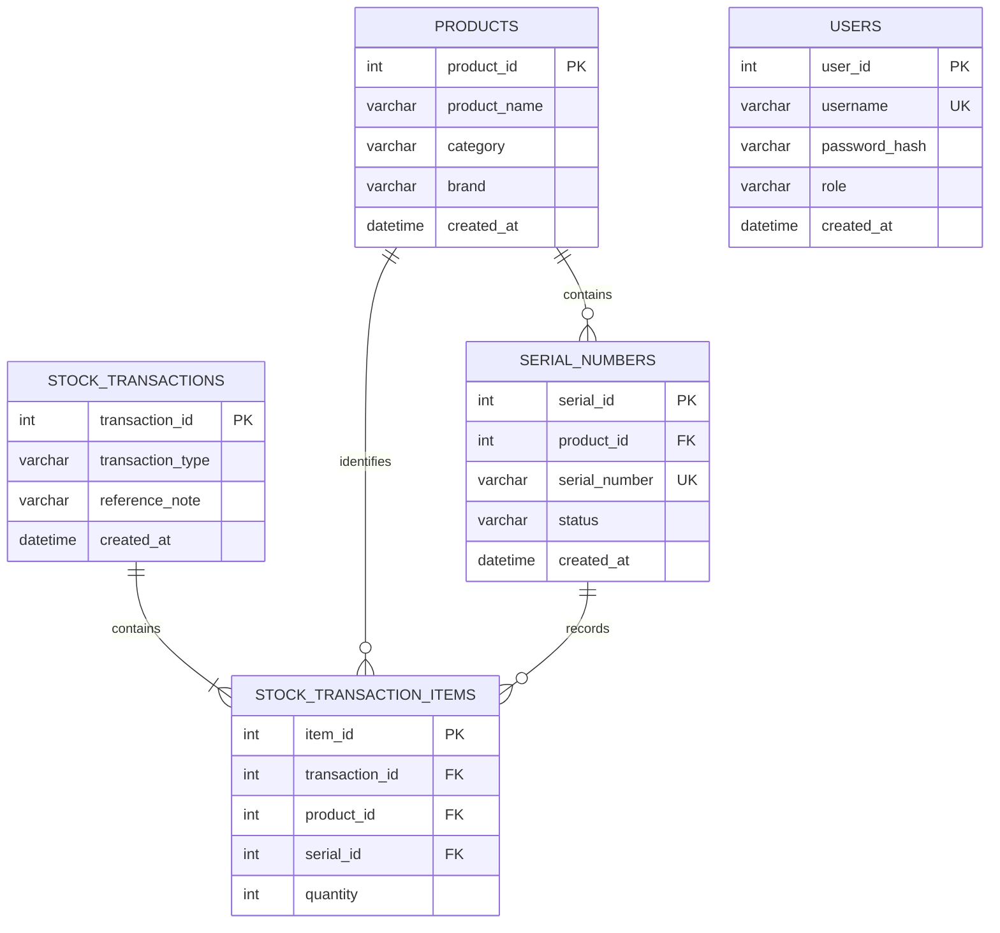

# SmartInventory database guide

The production schema is created and upgraded by Flyway migrations in `src/main/resources/db/migration`. Do not run the legacy `setup_database.sql`, `rebuild_db.sql`, or `fix_tables.sql` against a production database: they drop tables and are retained only as historical development material.

## Entity relationship diagram

## Data rules

- A product can have many serial numbers. A serial number is globally unique and has exactly one product.
- `available`, `sold`, and `damaged` are the only serial statuses. Only a stock-out operation can move an item to `sold`; administrators may mark an available item `damaged`.
- A stock transaction is immutable audit history. It contains one or more line items, each identifying the product and physical serial moved.
- Products with serial history must not be deleted. Archive such products in a future catalogue-management feature.
- Application users store BCrypt password hashes only. Production never creates demo accounts automatically.

## Operations

1. Configure the secrets named in `.env.example` in the hosting environment.
2. Deploy the application. Flyway creates a new schema or records a baseline for an existing one.
3. For the first start only, provide `APP_BOOTSTRAP_ADMIN_USERNAME` and `APP_BOOTSTRAP_ADMIN_PASSWORD` (minimum 12 characters). The application creates one BCrypt-protected admin only when the users table is empty. Remove both variables after the first successful deployment.
4. Back up the database before every migration and restrict the application database user to the required schema privileges.

## Recommended database user permissions

Grant the application account only `SELECT`, `INSERT`, `UPDATE`, `DELETE`, `CREATE`, `ALTER`, and `INDEX` on the application schema while migrations are enabled. Use a separate migration account if your platform supports it. Do not use a cloud root account from the application.
